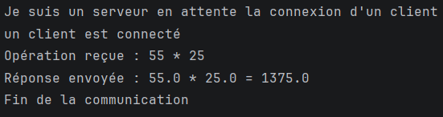
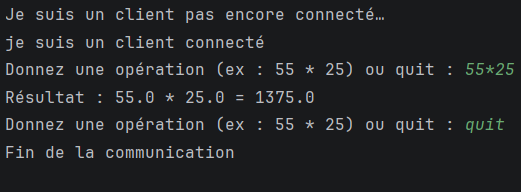
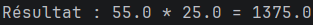
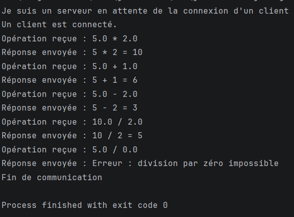
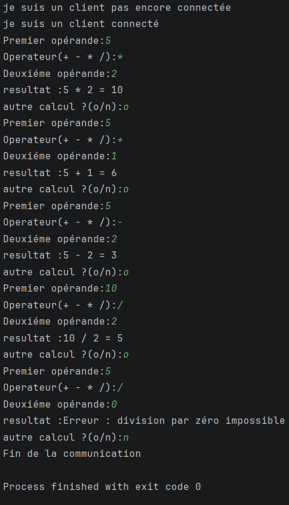
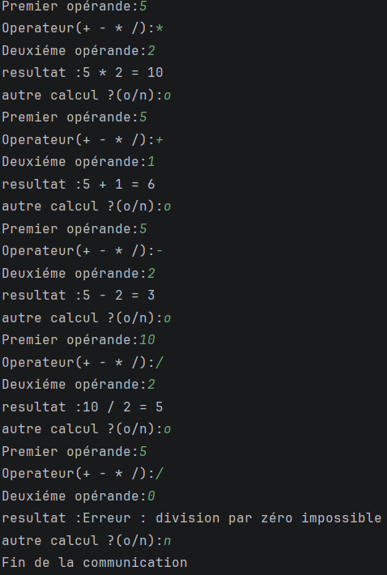

# TP 2 — Les sockets en mode connecté TCP : Échange de chaînes de caractères et d’objets

| Rubrique | Information |
| :--- | :--- |
| **Module** | Développement d’applications réparties |
| **TP** | TP 2 — Les sockets en mode connecté TCP : E/R de CC et objets |
| **Étudiante** | Salima Fourati |
| **Groupe** | LSI 3 2TP2 |
| **Année universitaire** | 2026–2027 |
| **Langage** | Java |
| **IDE** | IntelliJ IDEA |
| **JDK** | 25.0.2 LTS |
| **Gestion de versions** | Git et GitHub |

## 1. Présentation du TP

Ce TP a pour objectif de mettre en pratique la communication entre une application cliente et une application serveur en Java, en utilisant les sockets TCP en mode connecté.

Il est composé de deux activités :

- **Activité 2-1 :** échange de chaînes de caractères entre un client et un serveur pour effectuer des opérations arithmétiques.
- **Activité 2-2 :** échange d'objets Java sérialisables entre un client et un serveur pour transmettre les informations nécessaires à une opération.

Ces deux activités permettent de comprendre les mécanismes de communication réseau et l'utilisation des flux de traitement Java.

## 2. Environnement de travail

- **JDK :** version 25.0.2 LTS
- **IDE :** IntelliJ IDEA 2026.2.3
- **Système d'exploitation :** Windows
- **Gestion de versions :** Git
- **Hébergement du projet :** GitHub

## 3. Structure du projet

```text
TP2-DAR2026/
│
├── src/
│   ├── ClientPackage/
│   │   ├── Client.java
│   │   └── Client2.java
│   │
│   ├── ServerPackage/
│   │   ├── Serveur.java
│   │   └── Serveur2.java
│   │
│   └── SharedPackage/
│       └── Operation.java
│
├── captures/
│   ├── serveur.png
│   ├── client.png
│   └── resultat.png
│   ├── serveur2.png
│   ├── client2.png
│   └── resultat2.png
│
└── README.md
```

### Description des classes

| Classe | Rôle |
|---|---|
| `Client.java` | Envoie une opération sous forme de chaînes de caractères et affiche le résultat reçu. |
| `Serveur.java` | Reçoit les éléments de l'opération, effectue le calcul et renvoie le résultat. |
| `Client2.java` | Crée et envoie un objet `Operation`, puis reçoit et affiche le résultat. |
| `Serveur2.java` | Reçoit l'objet, récupère ses attributs, effectue le calcul et renvoie le résultat. |
| `Operation.java` | Représente une opération arithmétique et permet sa sérialisation. |

---

# Activité 2-1 — Échange de chaînes de caractères entre Client et Serveur

## 4. Objectif

L'objectif de cette activité est de permettre au client d'envoyer une opération arithmétique complète au serveur.

Le client envoie le premier opérande, l'opérateur et le deuxième opérande sous forme de chaînes de caractères.

Le serveur effectue le calcul et renvoie le résultat au client.

## 5. Fonctionnement

### Étape 1 : Établissement de la connexion

Le serveur crée un objet `ServerSocket` sur le port `1234` et attend une connexion avec la méthode `accept()`.

Le client se connecte au serveur en utilisant :

```java
Socket socket = new Socket("localhost", 1234);
```

### Étape 2 : Saisie et validation de l'opération

Le client demande à l'utilisateur de saisir une opération, par exemple :

```text
55 * 25
```

Une expression régulière permet de vérifier la syntaxe avant l'envoi. Les opérations acceptées utilisent les opérateurs suivants :

- Addition : `+`
- Soustraction : `-`
- Multiplication : `*`
- Division : `/`

Si la syntaxe est incorrecte, l'opération n'est pas envoyée au serveur.

### Étape 3 : Envoi des données

Le client utilise `PrintWriter` pour envoyer les trois éléments sur des lignes séparées :

```java
pw.println(m.group(1));
pw.println(m.group(2));
pw.println(m.group(3));
```

Le serveur utilise `BufferedReader` et la méthode `readLine()` pour recevoir ces éléments.

### Étape 4 : Calcul et réponse

Le serveur utilise la méthode `calculer()` pour effectuer l'opération demandée.

Le résultat est ensuite envoyé au client avec `PrintWriter`. Le client le récupère avec `BufferedReader` et l'affiche.

### Étape 5 : Fin de communication

Lorsque l'utilisateur saisit `quit`, le client envoie ce message au serveur pour signaler la fin de la communication.

## 6. Captures d'écran — Activité 2-1

### 6.1. Serveur

Cette capture montre le serveur en attente d'une connexion, puis la réception de l'opération et l'envoi du résultat.



### 6.2. Client

Cette capture montre la connexion du client et la saisie d'une opération arithmétique.



### 6.3. Résultat

Exemple de résultat attendu :

```text
Donnez une opération (ex : 55 * 25) ou quit : 55 * 25
Résultat : 55 * 25 = 1375
```



---

# Activité 2-2 — Échange d'objets entre Client et Serveur

## 7. Objectif

Cette activité consiste à utiliser les flux d'objets Java pour transmettre une opération arithmétique complète entre un client et un serveur.

Contrairement à l'activité précédente, les données ne sont plus envoyées séparément sous forme de chaînes de caractères. Elles sont regroupées dans un objet Java qui contient les deux opérandes et l'opérateur.

## 8. Classe Operation

La classe `Operation` est déclarée dans le package `SharedPackage`.

Elle implémente l'interface `Serializable`, qui permet à un objet d'être converti en une représentation transmissible par un flux d'objets.

Elle contient trois attributs :

- `operande1` : premier opérande de type `double`.
- `operateur` : opérateur arithmétique de type `char`.
- `operande2` : deuxième opérande de type `double`.

Le constructeur initialise les trois attributs et les méthodes getters permettent au serveur de récupérer leurs valeurs.

L'attribut `serialVersionUID` identifie la version de la classe sérialisable.

## 9. Fonctionnement

### Étape 1 : Établissement de la connexion

Le serveur crée un `ServerSocket` sur le port `1234`, puis attend la connexion du client.

Le client se connecte à l'adresse `localhost` sur le même port.

### Étape 2 : Création de l'objet

Le client demande à l'utilisateur de saisir les deux opérandes et l'opérateur.

Il crée ensuite un objet `Operation` :

```java
Operation operation = new Operation(x, op.charAt(0), y);
```

### Étape 3 : Envoi de l'objet

Le client utilise `ObjectOutputStream` pour envoyer l'objet :

```java
oos.writeObject(operation);
oos.flush();
```

Le serveur utilise `ObjectInputStream` et la méthode `readObject()` pour recevoir l'objet.

Les flux sont créés dans le même ordre des deux côtés : le flux de sortie `ObjectOutputStream` est créé en premier, puis le flux d'entrée `ObjectInputStream`.

### Étape 4 : Récupération des données

Le serveur vérifie que l'objet reçu est une instance de `Operation`, puis récupère ses attributs grâce aux getters :

```java
double a = op.getOperande1();
char operateur = op.getOperateur();
double b = op.getOperande2();
```

### Étape 5 : Calcul et envoi du résultat

Le serveur utilise la méthode `calculer()` pour effectuer l'opération arithmétique.

Le résultat est envoyé au client sous forme de chaîne de caractères avec `ObjectOutputStream`.

Le client récupère la réponse avec `ObjectInputStream` et l'affiche à l'écran.

### Étape 6 : Fin de communication

Le client permet à l'utilisateur d'effectuer plusieurs calculs. Lorsqu'il souhaite terminer, il envoie la chaîne `"FIN"` au serveur.

Le serveur quitte alors sa boucle de réception, car `"FIN"` n'est pas un objet de type `Operation`, puis ferme la connexion.

## 10. Captures d'écran — Activité 2-2

### 10.1. Serveur

Cette capture montre le serveur en attente de la connexion, la réception de l'objet `Operation` et l'envoi du résultat.



### 10.2. Client

Cette capture montre la saisie des opérandes et de l'opérateur par le client.



### 10.3. Résultat

Exemple de résultat attendu :

```text
Premier opérande : 55
Operateur (+ - * /) : *
Deuxiéme opérande : 25
resultat : 55 * 25 = 1375
autre calcul ? (o/n): n
Fin de la communication
```



---

## 11. Comparaison entre les deux activités

| Critère | Activité 2-1 | Activité 2-2 |
|---|---|---|
| Type de données échangées | Chaînes de caractères | Objets Java et chaîne de réponse |
| Flux utilisés | `BufferedReader`, `PrintWriter` | `ObjectInputStream`, `ObjectOutputStream` |
| Transmission de l'opération | Trois éléments envoyés séparément | Un objet `Operation` |
| Sérialisation | Non utilisée pour l'opération | Interface `Serializable` |
| Calcul | Addition, soustraction, multiplication et division | Addition, soustraction, multiplication et division |
| Communication | Sockets TCP | Sockets TCP |

---

## 12. Conclusion

Ce TP m'a permis de mettre en œuvre une communication client-serveur en Java à l'aide des sockets TCP.

La première activité m'a permis de comprendre l'échange de chaînes de caractères avec les flux de traitement. La deuxième activité m'a permis d'approfondir cette communication en transmettant des objets sérialisables à l'aide de l'interface `Serializable`.

Ces deux approches permettent de comprendre comment échanger des données entre des applications réparties et comment utiliser les flux Java adaptés à chaque type de données.
